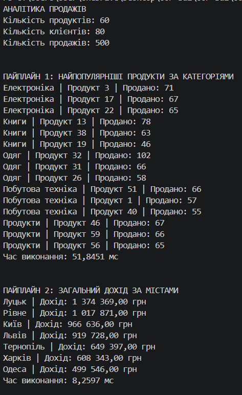
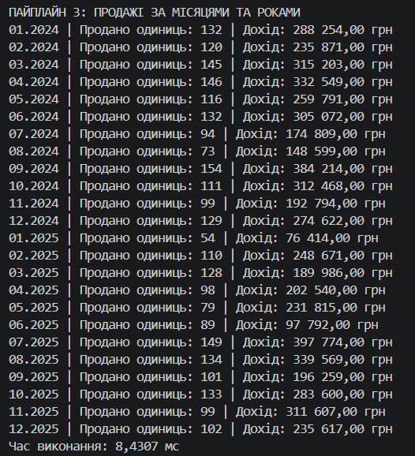
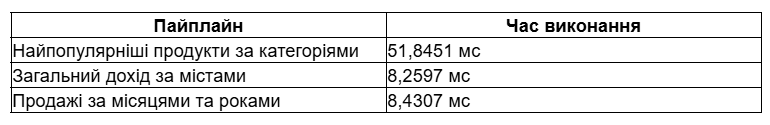

# Cамостійна робота №17
## Тема: LINQ pipelines: ETL та аналітика.
### Мета: Розробити та проаналізувати LINQ-пайплайни для обробки даних, які імітують процеси ETL та виконання аналітичних запитів.
У ході роботи було створено консольний проєкт IndependentWork11 для аналізу даних про продажі. У програмі реалізовано три класи: Sale, Product та Customer.
Для перевірки роботи створено тестові колекції, які містять 60 продуктів, 80 клієнтів і 500 продажів. Дані генеруються за допомогою Random із фіксованим значенням Seed = 42, тому результати можна відтворити під час повторного запуску програми.

### Реалізовані LINQ-пайплайни
1. Найпопулярніші продукти за категоріями
Метою цього запиту було визначити три найпопулярніші продукти в кожній категорії. Спочатку продажі групуються за ID продукту, після чого для кожного продукту обчислюється загальна кількість проданих одиниць.
Далі за допомогою Join результати об'єднуються з колекцією продуктів, щоб отримати їхні назви та категорії. Після цього використовується GroupBy для групування за категоріями, OrderByDescending для сортування за кількістю продажів і Take(3) для вибору трьох найпопулярніших продуктів.

2. Загальний дохід за містами клієнтів
Цей запит призначений для визначення доходу від продажів у кожному місті. За допомогою Join продажі об'єднуються з продуктами та клієнтами. Для кожного продажу обчислюється дохід шляхом множення кількості товарів на ціну одного товару.
Потім оператор GroupBy групує результати за містами, а Sum обчислює загальний дохід. Оператор OrderByDescending сортує міста від найбільшого доходу до найменшого.

3. Продажі за місяцями та роками
Метою третього запиту було проаналізувати продажі за окремими місяцями та роками. Спочатку за допомогою Join продажі об'єднуються з інформацією про продукти, щоб отримати їхню вартість.
Далі GroupBy групує продажі за роком і місяцем. Для кожної групи за допомогою Sum обчислюється загальна кількість проданих одиниць і дохід. Оператори OrderBy та ThenBy впорядковують результати за роком і місяцем.

### Результати вимірювання продуктивності
Для вимірювання часу виконання кожного пайплайна використано клас Stopwatch із простору імен System.Diagnostics.
