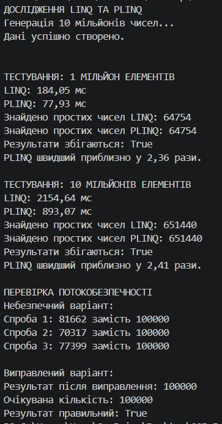

# Самостійна робота №18
## Тема: PLINQ: дослідження продуктивності та безпеки.
### Мета: Дослідити переваги та недоліки PLINQ у порівнянні зі звичайним LINQ, виміряти швидкість їх роботи на різних обсягах даних і перевірити проблеми, які можуть виникати під час паралельної обробки.
У ході роботи було створено консольний проєкт IndependentWork12. Для дослідження згенеровано 10 мільйонів випадкових чисел. Генерація виконується з фіксованим значенням Seed = 42, тому набір даних залишається однаковим під час повторних запусків.
Як обчислювальну операцію обрано перевірку чисел на простоту. Програма перевіряє, чи є кожне число простим, а потім порівнює результати двох способів обробки: звичайного LINQ та PLINQ.

### Порівняння продуктивності
Для вимірювання часу використано клас Stopwatch. Експерименти проведено на двох наборах даних: 1 мільйон і 10 мільйонів елементів.

Результати показують, що паралельна обробка може бути ефективнішою для великих наборів даних і складних обчислень. На швидкість також впливають кількість ядер процесора, завантаженість комп'ютера та витрати на розподіл роботи між потоками.
### Перевірка потокобезпечності
Для дослідження проблеми побічних ефектів було створено спільну змінну counter, яку декілька потоків одночасно збільшували за допомогою counter++.
Під час трьох запусків програма отримала різні результати: 81 662, 70 317 та 77 399 замість очікуваних 100 000. Це відбувається через те, що декілька потоків можуть одночасно змінювати одне значення, через що частина змін втрачається.
Для виправлення проблеми використано Interlocked.Increment(). Цей метод виконує збільшення змінної як одну атомарну операцію, тому одночасне звернення потоків не призводить до втрати результатів.
Після виправлення програма отримала правильне значення — 100 000.