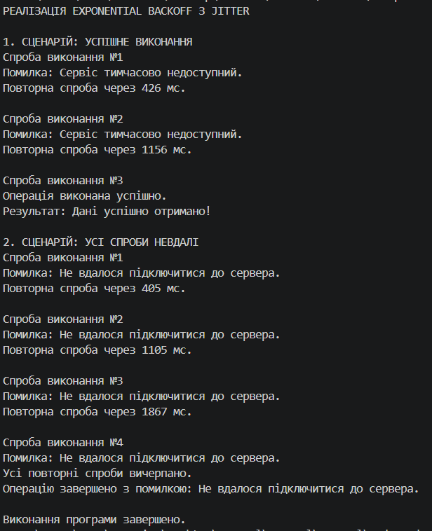

# Самостійна робота №20
## Тема: Реалізація exponential backoff.
### Мета: Розробити власний допоміжний клас RetryPolicy для повторного виконання операцій з експоненційною затримкою та випадковим відхиленням часу очікування (jitter).
У програмі реалізовано клас RetryPolicy, який відповідає за повторне виконання операцій після виникнення помилок. Він містить три приватні поля: _maxRetries — максимальна кількість повторних спроб, _initialDelay — початкова затримка та _jitterFactor — коефіцієнт випадкового відхилення.
Основним методом класу є Execute<T>. Він приймає операцію типу Func<T> та необов'язковий делегат shouldRetry, за допомогою якого можна визначити, чи потрібно повторювати операцію після певної помилки.
Для розрахунку часу очікування використовується формула експоненційного backoff:
delay = initialDelay * Math.Pow(2, retryAttempt) * (1 + random.NextDouble() * jitterFactor * 2 - jitterFactor)
Після кожної невдалої спроби базова затримка збільшується вдвічі. Випадкова складова jitter додає відхилення до розрахованого часу. Для очікування між спробами використовується Thread.Sleep.

Перевірка роботи програми
У методі Main було реалізовано два сценарії.
1. Успішне виконання після кількох спроб
У першому сценарії імітується звернення до сервісу. Перші дві спроби завершуються помилкою через тимчасову недоступність сервісу. Під час третьої спроби операція виконується успішно, а програма виводить повідомлення про отримання даних.

2. Невдале виконання після всіх спроб
У другому сценарії імітується підключення до сервера, яке щоразу завершується помилкою. Програма виконує початкову спробу та три повторні. Після вичерпання дозволеної кількості повторів виняток передається далі та обробляється через try-catch.

Під час запуску програми було отримано такі результати:
Перший сценарій завершився успішно з третьої спроби.
Другий сценарій завершився помилкою після чотирьох загальних спроб.
Час очікування змінювався завдяки експоненційному збільшенню затримки та випадковому jitter.

Межі застосування патерну Retry
Патерн Retry з exponential backoff підходить для операцій, які можуть тимчасово завершуватися помилками, наприклад звернення до API або підключення до сервера. Він допомагає уникнути надто частих повторних запитів.
Однак цей підхід не варто використовувати для помилок, які не зникнуть після повторення операції. Наприклад, якщо користувач ввів неправильні дані, повторне виконання не виправить ситуацію. Також потрібно враховувати, що повторні операції можуть призвести до дублювання дій, якщо попередній запит фактично виконався, але відповідь не надійшла.
