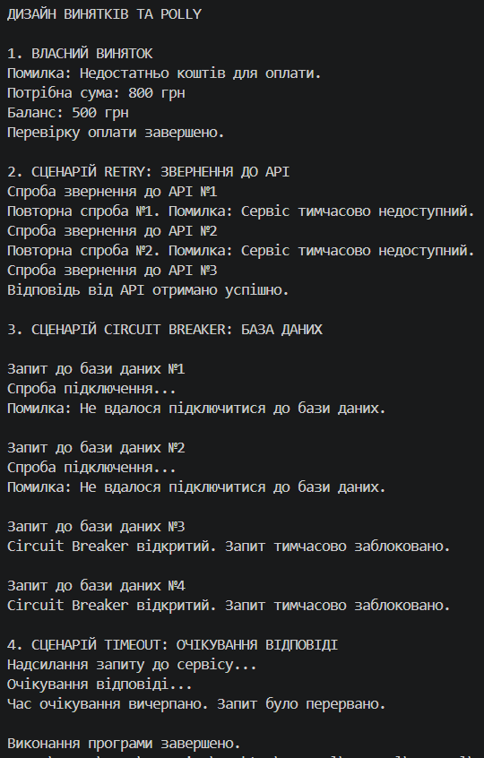

# Самостійна робота №19
## Тема: Дизайн винятків і політики retry: теорія та кейси Polly.
### Мета: Навчитися створювати власні типи винятків у C#, правильно обробляти помилки та використовувати бібліотеку Polly для повторних спроб виконання операцій, обмеження часу очікування і захисту від повторних невдалих запитів.
У ході роботи було створено консольний проєкт IndependentWork19 мовою C#. Для обробки помилок і налаштування політик повторного виконання використано бібліотеку Polly.
Спочатку було створено власний тип винятку InsufficientFundsException, який описує ситуацію з недостатньою кількістю коштів для оплати. Він містить додаткові властивості для збереження потрібної суми та поточного балансу. У програмі перевіряється оплата на суму 800 грн за балансу 500 грн. Виняток перехоплюється через try-catch, після чого виводиться повідомлення про помилку.

Далі було реалізовано три сценарії з використанням Polly.
1. Retry — повторні спроби
Цей сценарій імітує звернення до API, яке тимчасово недоступне. Для нього налаштовано три повторні спроби з поступовим збільшенням затримки. Перші два звернення завершуються помилкою, а третє проходить успішно. У консолі відображаються номери спроб і повідомлення про повторне звернення.

2. Circuit Breaker — автоматичне блокування запитів
У цьому сценарії імітується підключення до бази даних. Після двох невдалих спроб Polly відкриває Circuit Breaker і тимчасово блокує наступні запити. Завдяки цьому програма не продовжує виконувати операції, які наразі не можуть завершитися успішно.

3. Timeout — обмеження часу очікування
Для цього сценарію встановлено обмеження часу очікування 500 мілісекунд. Імітований запит виконується довше, тому Polly перериває його та повідомляє про перевищення часу очікування.

Результат виконання
Під час запуску програми було перевірено роботу власного винятку та трьох стратегій Polly. У першому сценарії програма правильно визначила недостатню кількість коштів. У сценарії Retry третє звернення до API завершилося успішно. Circuit Breaker заблокував запити після двох помилок підключення до бази даних. Timeout перервав запит після перевищення встановленого часу очікування.

Коли використовувати Exception, а коли Result<T>
Винятки (Exception) доцільно використовувати для ситуацій, коли під час виконання програми виникає помилка або непередбачена ситуація, наприклад неможливо підключитися до бази даних чи виконати оплату через недостатній баланс.
Result<T> краще підходить для очікуваних результатів роботи, коли операція може завершитися успішно або повернути звичайну помилку. Наприклад, під час перевірки даних користувача можна повернути повідомлення про неправильний формат електронної пошти, не створюючи виняток.
