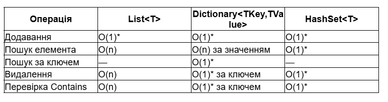

# Самостійна робота №14

## Тема: Вивчення Dictionary<TKey,TValue> та HashSet<T> у бібліотеках .NET

### Мета: Ознайомитися з колекціями `Dictionary<TKey,TValue>` та `HashSet<T>`, дослідити їх використання у відкритих проєктах, навчитися застосовувати їх для зберігання, пошуку та обробки даних.

## 1. Аналіз використання колекцій у відкритих репозиторіях
**Приклад Dictionary у проєкті .NET Runtime**
У файлі [SignedCms.cs](https://github.com/dotnet/runtime/blob/main/src/libraries/System.Security.Cryptography.Pkcs/src/System/Security/Cryptography/Pkcs/SignedCms.cs) використовується `Dictionary<string, X509Certificate2>`. Він зберігає сертифікати за спеціально сформованим ключем, який містить серійний номер та ім'я видавця сертифіката.
Таке рішення прискорює пошук потрібного сертифіката. Замість послідовного перегляду всієї колекції програма може звернутися до словника за ключем. У цьому випадку пошук у середньому виконується за O(1).

**Приклад HashSet у проєкті MSBuild**
У файлі [RoslynCodeTaskFactory.cs](https://github.com/dotnet/msbuild/blob/main/src/Tasks/RoslynCodeTaskFactory/RoslynCodeTaskFactory.cs) використовується `HashSet<string>` для зберігання допустимих назв мов програмування. Наприклад, для C# використовуються назви `CSharp` і `C#`, а для Visual Basic — `VisualBasic` і `Visual Basic`.
HashSet підходить для такого завдання, оскільки не допускає повторення однакових елементів і швидко перевіряє, чи міститься потрібне значення в наборі. Також використовується `StringComparer.OrdinalIgnoreCase`, тому перевірка не залежить від великих і малих літер.

**Додатковий приклад із .NET Runtime**
У файлі [ToCollection.cs](https://github.com/dotnet/runtime/blob/main/src/libraries/System.Linq/src/System/Linq/ToCollection.cs) реалізовані методи LINQ `ToDictionary()` та `ToHashSet()`. Вони перетворюють послідовність елементів відповідно на словник або множину. Це показує, що обидві колекції використовуються не лише окремо, а й у стандартних засобах обробки даних .NET.

## 2. Практична частина
У програмі реалізовано три приклади використання колекцій.
Клас `FileMetadataCache` зберігає метадані файлів у `Dictionary<string, FileMetadata>`. Назва файлу використовується як ключ, а значення містить його розмір, дату зміни та хеш. Реалізовано додавання, отримання, видалення та перевірку наявності файлу.

Клас `TagManager` використовує `Dictionary<string, HashSet<string>>`, де для кожної статті зберігається набір тегів. За допомогою `UnionWith()` програма отримує всі унікальні теги, `IntersectWith()` знаходить спільні, а `ExceptWith()` — ті, які не є спільними.

Клас `SearchIndex` створює пошуковий індекс на основі `Dictionary<string, HashSet<int>>`. Ключем є слово, а значенням — набір номерів документів, у яких воно зустрічається. Це дає змогу знаходити документи за одним або кількома словами.

Для порівняння текстових значень у кеші та менеджері тегів використано `StringComparer.OrdinalIgnoreCase`. Завдяки цьому назви файлів і теги не дублюються лише через різний регістр літер.

## 3. Порівняння складності операцій

\* Для `Dictionary` і `HashSet` значення O(1) вказане для середнього випадку. У найгіршому випадку через колізії операція може виконуватися за O(n). Для `List<T>` додавання в кінець має амортизовану складність O(1), а пошук і видалення — O(n).

## 4. Можливі проблеми під час роботи з колекціями
Під час використання `Dictionary` потрібно стежити, щоб ключі не повторювалися, і правильно обирати спосіб їх порівняння. Якщо додати вже наявний ключ методом `Add()`, виникне виняток. Також не слід змінювати об'єкти, які використовуються як ключі, якщо це впливає на їх хеш-код.
У `HashSet` однакові елементи не зберігаються повторно. Це зручно для роботи з унікальними значеннями, але потрібно враховувати, що порядок елементів не гарантується. Ще одна можлива проблема — колізії хеш-кодів, які можуть впливати на швидкість пошуку.

## Висновок
Під час самостійної роботи було досліджено використання `Dictionary<TKey,TValue>` та `HashSet<T>` у відкритих проєктах .NET і MSBuild. Створено програму для зберігання метаданих файлів, роботи з тегами та пошуку документів. На практиці використано додавання, пошук, видалення, об'єднання та перетин множин. Також було порівняно складність основних операцій колекцій `List`, `Dictionary` і `HashSet`.