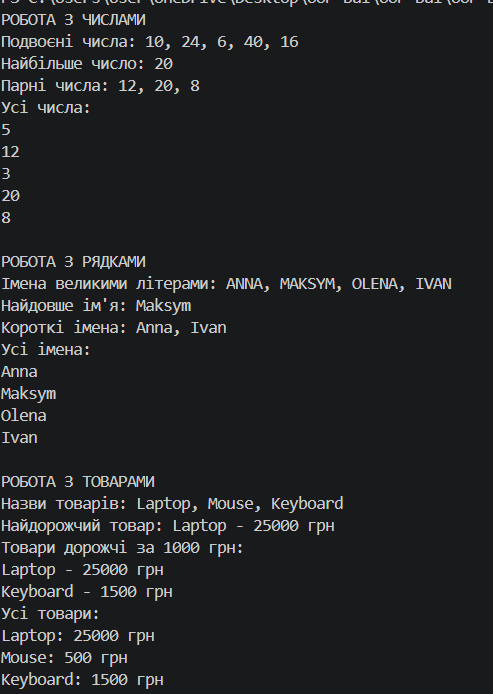

# Самостійна робота №15
## Тема: Делегати й лямбда-вирази: власні утиліти для колекцій.
### Мета: Поглибити розуміння делегатів та лямбда-виразів через створення власних узагальнених методів для роботи з колекціями.
У ході роботи було створено консольний проєкт lab9-self-vN. У файлі Program.cs реалізовано статичний клас CollectionUtils із чотирма узагальненими методами: Map, MaxBy, Filter та ForEach. Для перевірки роботи методів було створено три колекції: список чисел, список рядків і список товарів. Кожен метод викликається з використанням різних лямбда-виразів.

1. Чому делегати корисні для створення таких утиліт?
Делегати дозволяють передавати методи та дії як параметри. Завдяки цьому одна утиліта може працювати з різними типами даних і виконувати різні завдання. Наприклад, метод Filter може відбирати числа за однією умовою, а товари — за іншою.

2. Як лямбда-вирази спрощують виклик цих методів?
Лямбда-вирази дозволяють коротко записувати умови та дії без створення окремих методів. Наприклад, n => n * 2 подвоює число, а p => p.Price > 1000 відбирає товари дорожчі за 1000 грн. Це робить код коротшим і зрозумілішим.

3. Порівняння власних методів із вбудованими LINQ-операторами
Власні методи виконують подібні завдання до операторів LINQ. Метод Map є аналогом Select(), а Filter — аналогом Where(). Метод MaxBy також має відповідник у LINQ, який знаходить елемент із максимальним значенням ключа. ForEach виконує дію для кожного елемента колекції.
Головна відмінність полягає в тому, що власні методи потрібно реалізовувати самостійно, а LINQ уже містить готові інструменти для роботи з колекціями.